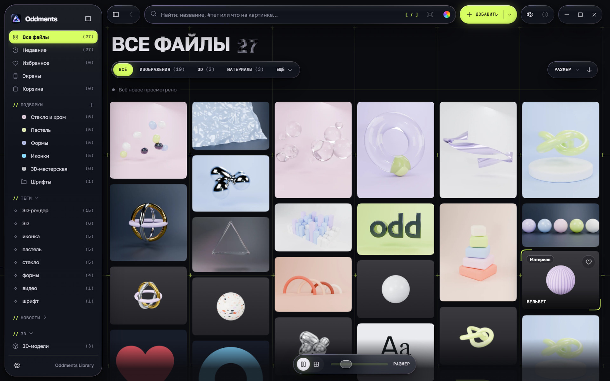
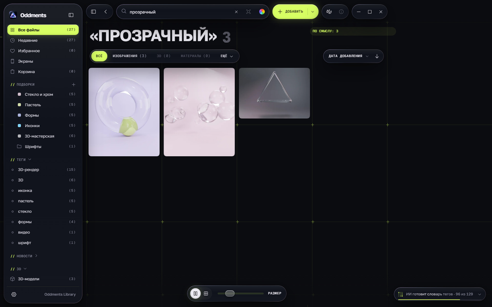
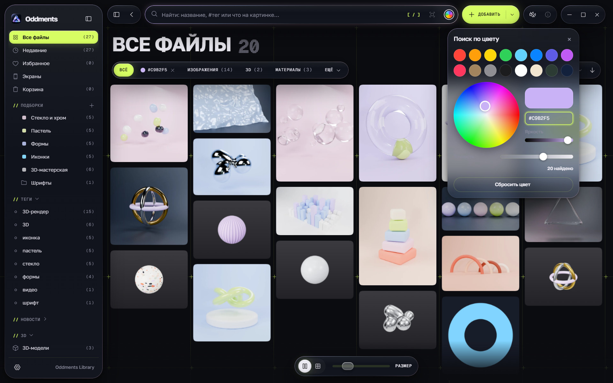
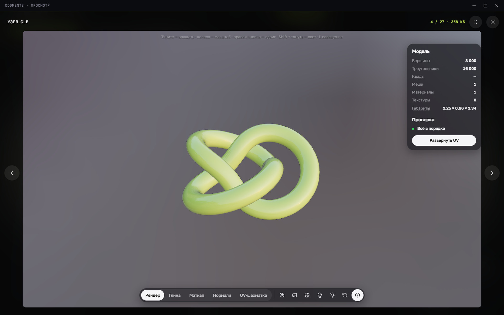
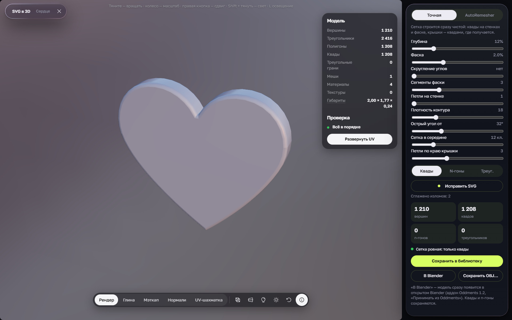
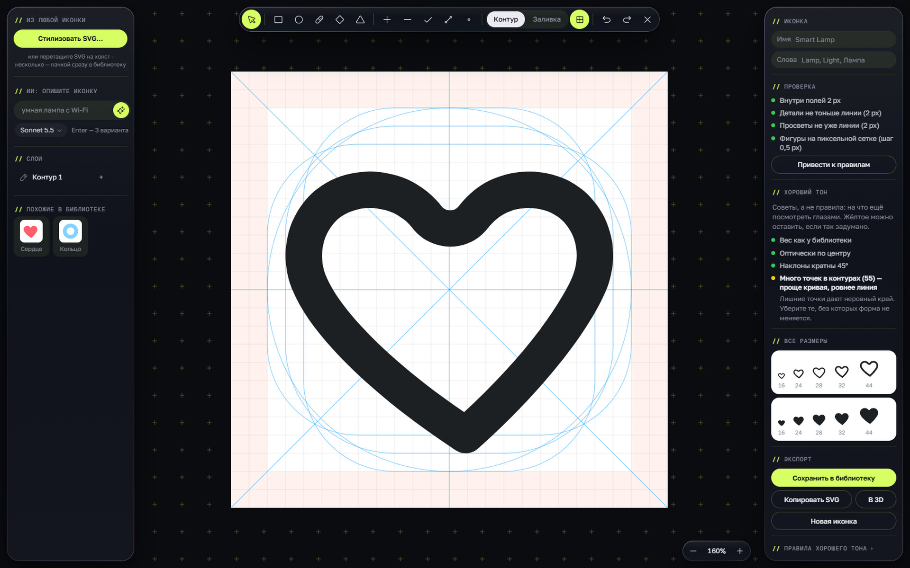
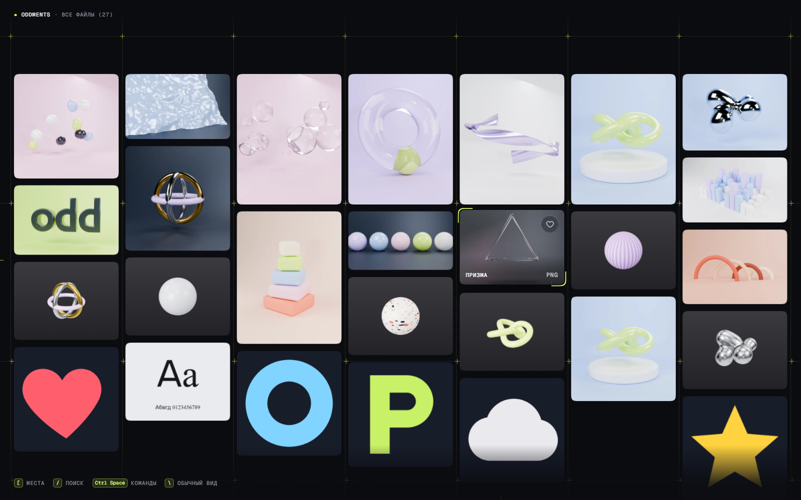

> **Русский:** документация есть и на русском — [README.ru.md](README.ru.md). The app runs in English or Russian:
> Settings › Look › Language (Настройки › Вид › Язык).

# Oddments

[](https://github.com/peopleskynet-boop/Oddments/releases/latest) [](https://github.com/peopleskynet-boop/Oddments/releases) [](https://github.com/peopleskynet-boop/Oddments/releases/latest) [](LICENSE) [](https://github.com/peopleskynet-boop/Oddments/stargazers)

**[⬇ Download for Windows and macOS](https://github.com/peopleskynet-boop/Oddments/releases/latest)** · free and open source, local-first: no account, no telemetry

A desktop reference manager for designers: images, video, GIF, 3D models, materials, fonts, PDF and PSD in one
library. The library is an ordinary folder on your disk, the originals are never changed, there is no account and no
cloud. Windows and macOS, English and Russian interface, MIT licence.



## What it does

- **Collects in one move.** Ctrl/⌘+V pictures from a browser, Figma or a screenshot, drag in files and links, the
  extension for Chrome, Edge and Safari, watched folders. YouTube, Vimeo and Pinterest as cards with a cover,
  Pinterest and Instagram videos as files.
- **Moves you over from Eagle and PureRef.** An Eagle library comes over with its folders, tags, notes and links;
  the pictures of PureRef boards become collections. The original libraries are not touched. Details —
  [docs/import.en.md](docs/import.en.md).
- **Captures interface blocks.** The extension picks any block of a page (a button, a card, a menu, a hero) and saves
  a shot with its HTML and styles. In Oddments the block opens live: hover shows the font, sizes, colours and spacing,
  a click copies the styles.
- **Finds.** Search by name and tags, by colour (a wheel, HEX, tolerance), similar files. AI search by meaning («a
  hand with headphones») — on the computer with SigLIP 2, without sending pictures anywhere, or through the Claude
  and Voyage API with your key. Text on pictures is read on the computer (PaddleOCR) and is searchable too.
- **Improves pictures.** ×2 / ×4 upscaling with Real-ESRGAN and background removal with BEN2, right on the computer,
  a before / after view with a loupe.
- **Shows.** A fast masonry for thousands of files, a carousel preview, its own video player (frame by frame, speed,
  A–B), a 3D viewer for GLB, OBJ, FBX, STL, USDZ and more (clay, normals, UV, HDRI lighting), Gaussian splats (PLY,
  SPZ), `.blend` previews and scenes through an installed Blender.
- **Works with 3D.** Materials (`.perchmat`) from textures in one click, «SVG to 3D» with a clean quad mesh and UVs,
  «Fix SVG», remeshing with AutoRemesher (Windows), a splat from a model. The Blender add-on: send and insert models and
  materials, icon sets from SVG to 3D with styles and a render, its own material library, a smart UV unwrap.
- **Makes icons.** An icon constructor with grid, margin and stroke rules, checks, a «smart» 16 px, restyling of any
  SVG and variants from a description.
- **Flows from screen recordings.** A phone or desktop video is cut into screens: a storyboard, «walk the flow», a
  CJM (stages, emotions, pains and hints from the recording), sent to Figma as a section with a prototype.
- **Works as a team.** A shared library in a network folder without a server, comments and marks on pictures, showing
  a collection and PDF export, research notes, brand rule checks, hiding personal data on screenshots.
- **Reads.** A design news feed as reels (RSS, open Telegram channels, designers' blogs and YouTube), a reader for
  saved articles with translation, an AI daily digest.
- **Connects to your tools.** A Figma plugin (the library inside Figma, moodboards, icons as components), an MCP
  server for Claude Desktop and Claude Code, dragging files out of Oddments into other programs.

| | |
|---|---|
|  |  |
|  |  |
|  |  |

## Install

Builds are on the [Releases](https://github.com/peopleskynet-boop/Oddments/releases) page: `Oddments_…_x64-setup.exe`
for Windows and `Oddments_…_universal.dmg` for the Mac (Apple Silicon and Intel). How to install, what to do if the
system asks on the first start, and how to uninstall — [docs/install.en.md](docs/install.en.md).

On the first start Oddments asks for the language, the library folder and what to turn on: AI search, text on
pictures, the update check or «Offline» mode. All of it can be changed later in Settings.

## Updates

Oddments can check once a day whether there is a new version — if you allowed it (in the first window or in
Settings › About). A new version comes as an «A new Oddments is out» toast, installs with one button and is signed with
the project's key: a file with someone else's signature is not installed. What changed — [CHANGELOG.en.md](CHANGELOG.en.md).

## Privacy

No analytics, no telemetry. The library, tags, notes and crash reports never leave the computer. Oddments goes online
only for what you turned on yourself (AI models, the feed, link covers, the API with your key, the update check), and
**«Offline»** mode turns all of it off with one switch. Details — [docs/privacy.en.md](docs/privacy.en.md).

If something breaks: Settings › About › «Crash report» › «Copy the report» — and send it to us. Oddments itself sends
nothing anywhere.

## Where the data is

- The library: `Documents/Oddments Library` (if a `Perch Library` from early versions exists, that one is used) —
  `index.json`, files in `files/<id>/`, index backups in `backups/`. The folder can be changed in Settings › Library.
- Settings — in the app window's storage; AI models, HDRIs, the integration token and crash reports — in the app's data
  folder (`%LOCALAPPDATA%\app.perch.desktop` on Windows, `~/Library/Application Support/app.perch.desktop` on the Mac).

## Building from source

```bash
npm ci
npm run tauri dev
```

In detail (what to install, the browser build for interface work, building the installer, tests) —
[docs/build.en.md](docs/build.en.md). Releasing a version, signing and updates — [docs/release.en.md](docs/release.en.md)
and [docs/signing.en.md](docs/signing.en.md).
A map of the code — [ARCHITECTURE.md](ARCHITECTURE.md), how to send a change — [CONTRIBUTING.md](CONTRIBUTING.md).

## Contact

Questions, bugs, ideas — write:
- Email: [peopleskynet@gmail.com](mailto:peopleskynet@gmail.com)
- Telegram: [@PeopleSkyNet](https://t.me/PeopleSkyNet)
- LinkedIn: [linkedin.com/in/alexander-park-725461267](https://www.linkedin.com/in/alexander-park-725461267/)
- Bugs can also go to [Issues](https://github.com/peopleskynet-boop/Oddments/issues).

## Licence

[MIT](LICENSE). Third-party libraries, models and resources with their licences — in
[THIRD_PARTY_NOTICES.md](THIRD_PARTY_NOTICES.md) and in the app: Settings › About › «Licences and authors».
