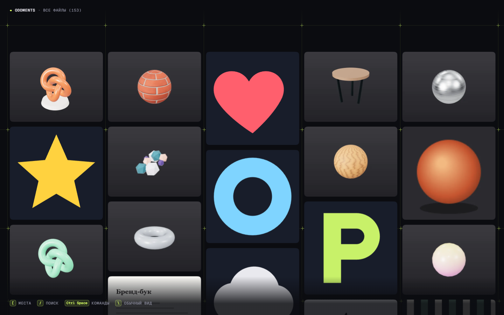
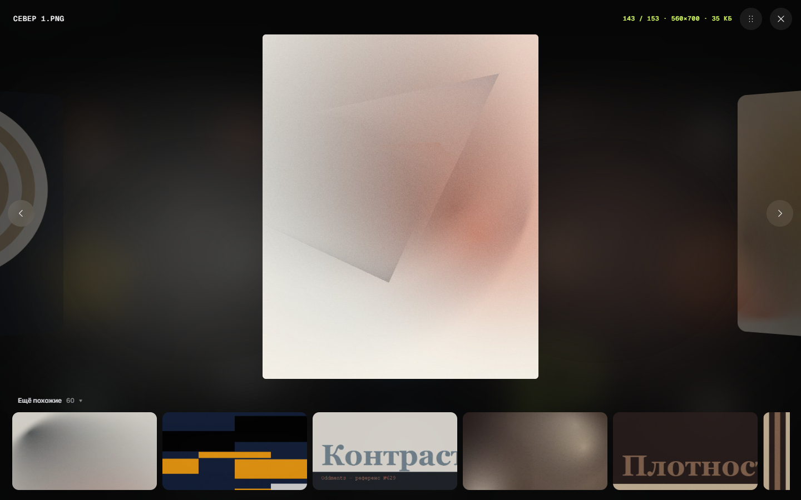
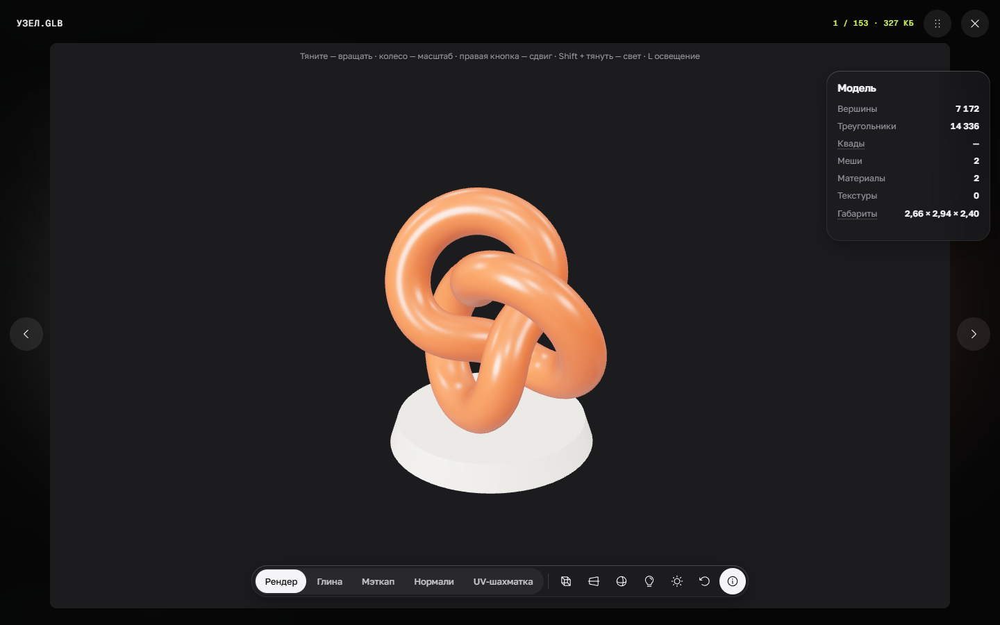
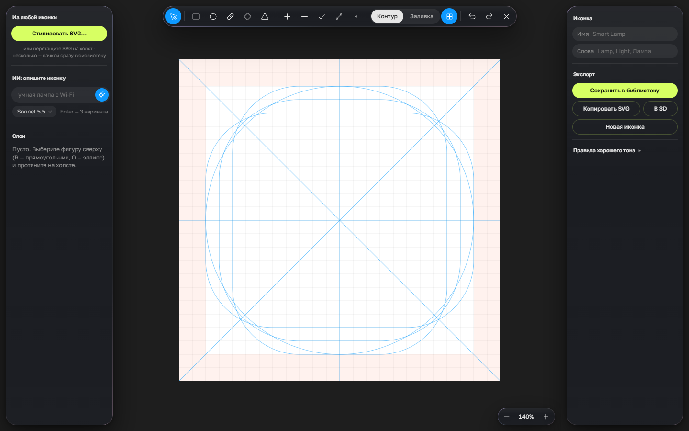

# Oddments

Настольный менеджер визуальных референсов для дизайнеров: картинки, видео, GIF, 3D-модели, материалы, шрифты, PDF и
PSD в одной библиотеке. Библиотека — обычная папка на диске, оригиналы не меняются. Windows и macOS.

*A desktop reference manager for designers: images, video, 3D models, materials, fonts, PDF and PSD in one local
library. The interface is in Russian for now. Windows and macOS, MIT licence.*



## Что умеет

- **Собирать в одно движение.** Ctrl/⌘+V картинки из браузера, Figma или скриншота, перетаскивание файлов и ссылок,
  расширение для Chrome, Edge и Safari, папки-наблюдатели. YouTube, Vimeo и Pinterest — карточками с обложкой,
  видео Pinterest и Instagram — файлом.
- **Забирать блоки интерфейса.** Расширение выделяет любой блок страницы (кнопку, карточку, меню, первый экран) и
  сохраняет снимок вместе с HTML и стилями. В Oddments блок открывается живым: при наведении видны шрифт, размеры,
  цвета и отступы, стили копируются кликом.
- **Находить.** Поиск по названию и тегам, по цвету (круг, HEX, точность), похожие файлы. ИИ-поиск по смыслу
  («рука с наушниками») — локально моделью SigLIP 2, без отправки картинок, или через API Claude и Voyage по вашему ключу.
- **Смотреть.** Быстрая мозаика на тысячи файлов, просмотр с каруселью, свой видеоплеер (покадрово, скорость, A–B),
  3D-просмотр GLB, OBJ, FBX, STL, USDZ и других (режимы глины, нормалей, UV, HDRI-освещение), `.blend` — превью и сцена
  через установленный Blender.
- **Работать с 3D.** Материалы (`.perchmat`) из текстур в один клик, «SVG в 3D» с чистой квадовой сеткой, ремеш через
  AutoRemesher (Windows), аддон Blender: отправка и вставка моделей и материалов, своя библиотека материалов Blender.
- **Делать иконки.** Конструктор иконок с правилами сетки, полей и толщин, проверками, «умным» 16 px, стилизацией любых
  SVG и генерацией вариантов по описанию.
- **Сценарии из записи экрана.** Видео с телефона или компьютера режется на экраны: раскадровка, «пройти сценарий»,
  перенос в Figma секцией с прототипом.
- **Читать.** Лента дизайн-новостей в формате рилсов (RSS, открытые каналы Telegram, блоги и YouTube дизайнеров),
  читалка сохранённых статей с переводом, ИИ-сводка дня.
- **Связываться с инструментами.** Плагин Figma (библиотека внутри Figma, мудборды, иконки компонентами), MCP-сервер
  для Claude Desktop и Claude Code, перетаскивание файлов из Oddments в другие программы.

| | |
|---|---|
|  |  |
|  | |

## Установка

Готовые сборки — на странице [Releases](../../releases): `Oddments_…_x64-setup.exe` для Windows и `Oddments_…_universal.dmg`
для Mac. Приложение пока не подписано — как открыть его в первый раз, написано в [docs/install.md](docs/install.md).

## Сборка из исходников

Коротко:

```bash
npm ci
npm run tauri dev
```

Подробно (что поставить, веб-версия для работы над интерфейсом, сборка установщика, тесты) — [docs/build.md](docs/build.md).

## Где лежат данные

- Библиотека: `Документы/Perch Library` (имя папки осталось от первого названия проекта) — `index.json`, файлы
  в `files/<id>/`, резервные копии индекса в `backups/`.
- Настройки — в хранилище окна приложения; модель ИИ, токен интеграций и HDRI — в папке данных приложения
  (`%LOCALAPPDATA%\app.perch.desktop` на Windows, `~/Library/Application Support/app.perch.desktop` на Mac).
- В сеть уходят только запросы, которые вы включили сами: ленты новостей, скачивание модели ИИ, API по вашему ключу.

## Лицензия

[MIT](LICENSE). Сторонние библиотеки и ресурсы — в [THIRD_PARTY_NOTICES.md](THIRD_PARTY_NOTICES.md).
